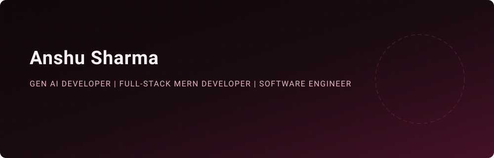

<!-- Animated Hero Banner -->

  

## 💫 About Me
Generative AI and full-stack engineer who builds NLP and MERN products end-to-end—from Hugging Face transformer pipelines and Text-to-Speech voice output to JWT-secured REST APIs and responsive React interfaces. Passionate about creating intelligent, accessible digital solutions.

- 🎓 **Education**: B.Tech in Computer Science & Engineering at Ramgarh Engineering College (2022–2026 | CGPA: 7.43)
- 📍 **Location**: Ranchi, Jharkhand, India
- 💡 **Focus Areas**: Generative AI, NLP, Full-Stack MERN Development, Machine Learning

---

## 🏆 Leadership & Campus Involvement
- 🚀 **Tech Lead**: Google Developer Groups (GDG) on Campus, Ramgarh Engineering College
- 🏛️ **Leadership Lead**: REC IPR Students Club
- 🎯 **Initiatives**: Organized and led "Hackmanthon" (the first 24-hour hackathon at REC) and drove Google Cloud Study Jam reaching 100+ student participants.

---

## 🛠️ Tech Stack & Skills

| Category | Technologies |
| :--- | :--- |
| **AI / ML / NLP** | Generative AI, NLP, NLU, LLMs, RAG, HuggingFace Transformers, Text-to-Speech (TTS), Scikit-learn, Random Forest, Pandas, NumPy |
| **Full Stack / MERN** | React.js, Node.js, Express.js, MongoDB, JavaScript (ES6+), REST API Design, JWT Authentication, HTML5, CSS3, Responsive Web Design |
| **Languages & Tools** | Python, JavaScript, C, Git, GitHub, Streamlit, FastAPI, Power BI, Postman, MySQL, Agile / Iterative Development |

---

## 📌 Featured Projects

### 🤖 SevSetu - Indigenous Language Chatbot for Government Services
> *Python, HuggingFace Transformers, NLP, NLU, TTS* | [Repository](https://github.com/AnshuBANKAI/SevSetu)
- Engineered a multilingual Generative AI chatbot that translates and streams government notifications across Bhojpuri, Hindi, and English.
- Built Natural Language Understanding (NLU) and Text-to-Speech (TTS) pipelines delivering regional-language voice output to extend service access for non-English speakers.

### 📚 Book Store Management System
> *MongoDB, Express.js, React.js, Node.js, REST API, JWT* | [Repository](https://github.com/AnshuBANKAI/Book-Management-)
- Developed a full-stack MERN application with JWT-based user authentication and complete CRUD functionality for book inventory management.
- Designed a RESTful API backend integrated with a React.js front end for reliable client-server data flow.

### 🏥 Hospital Bill Predictor System
> *Python, Pandas, Scikit-learn, Random Forest, Streamlit* | [Repository](https://github.com/AnshuBANKAI/Hospital-bills-)
- Trained and evaluated a Random Forest regression model predicting hospital expenses from patient data with ~90% accuracy.
- Shipped an interactive Streamlit interface for real-time predictions, demonstrating end-to-end machine learning deployment.

---

## 💼 Professional Experience

- **Web Development Intern** | *Techoctanet Services Pvt. Ltd. (OctaNet)* (Remote | Jul – Aug 2025)
  - Built a responsive full-stack web application spanning front-end and back-end components.
  - Implemented and optimized REST API integrations between the front end and back end.
- **Data Science Intern** | *Cognifyz Technologies* (Remote | Jun – Jul 2025)
  - Analyzed multiple Kaggle datasets across data cleaning, EDA, and model building.
  - Built Python (Pandas, NumPy) visualizations supporting data-driven business recommendations.

---

## 📜 Certifications
- **Full Stack Development** – GeeksforGeeks[cite: 7]
- **Data Analysis Using Python** – IBM[cite: 7]
- **Postman API Fundamentals** – Student Expert[cite: 7]

---

## 📊 Activity & Stats

<!-- Genuine Contribution Heatmap Embed -->

  

---

## 📬 Connect With Me

  
  
  

 

<!-- Minimal Animated Footer -->

  

